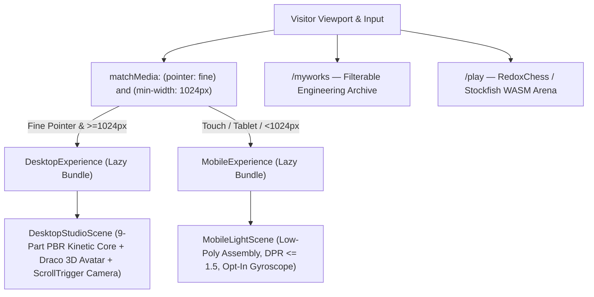

# Narasimha Manam — 3D Interactive Engineering Portfolio

[](https://react.dev/)
[](https://threejs.org/)
[](https://www.typescriptlang.org/)
[](https://vitejs.dev/)
[](https://vercel.com)

The interactive engineering portfolio of **Narasimha Manam** (Full Stack Developer & Generative AI Engineer). Designed with a restrained, glass-polished architectural aesthetic, dual-theme token system (`Light` warm off-white `#F4F2EE` and `Dark` deep ink `#0E1116`), runtime-split `DesktopExperience` and `MobileExperience` bundles, scroll-choreographed 3D WebGL studio scenes, and an embedded client-side **Stockfish / RedoxChess WebAssembly Arena**.

---

## Architecture & Runtime Experience Split



### Key Architectural Highlights
- **Design Token System (`src/styles/tokens.css`):** Shared CSS custom properties governing color (`--bg-canvas`, `--text-primary`, `--accent-primary` steel-blue, `--accent-sage`), fluid `clamp()` typography (`Plus Jakarta Sans`, `Fraunces`, `JetBrains Mono`), 8px spatial rhythm, and restrained glassmorphism (`backdrop-filter: blur(20px) saturate(140%)`).
- **Dual-Theme Persistence (`src/hooks/useTheme.tsx`):** Respects `prefers-color-scheme`, persists user selection to `localStorage`, and hydrates synchronously in `index.html` to eliminate flash of unstyled content.
- **Separate Desktop & Mobile Experiences:**
  - `DesktopExperience`: Split-screen hero with a 9-part procedural PBR kinetic sculpture and optional encrypted 3D avatar toggle, collapsible bottom scene control dock, mouse-parallax camera, scroll-linked transforms, horizontal project showcase, and magnetic cursor.
  - `MobileExperience`: Thumb-centric single-column layout with `>= 44px` touch targets, swipeable horizontal snap project cards, lightweight 3D scene (`DPR <= 1.5`), and a compact bottom glass navigation bar.
- **Featured Engineering Projects:**
  1. **ADAM-1 Enhanced** — AI Research & Microbiome Analysis Platform (`React, FastAPI, PostgreSQL, pgvector, LLM Integration`)
  2. **Simha AI** — Multi-Agent LLM & RAG Platform (`LLaMA 3.3, FastAPI, React, MongoDB, RAG`)
  3. **ResumePilot** — AI Resume Optimization & ATS Evaluation Platform (`React, TypeScript, Generative AI`)
  4. **Smart Loan / AI Loan Risk** — Machine Learning Loan Approval System (`Python, Scikit-learn, Pandas, Streamlit`)
  - Plus secondary repository projects: **NeuroXAI**, **CineSnap**, and **Interactive 3D Portfolio**.

---

## Project Structure

```text
/
├── public/
│   ├── draco/                        # Draco WASM/JS decoders
│   ├── models/                       # Encrypted 3D avatar & HDR environment
│   ├── projects/                     # High-resolution project previews
│   ├── portrait.jpeg                 # Developer portrait
│   ├── redoxchess.js                 # Web Worker chess engine wrapper
│   └── redoxchess.wasm               # WebAssembly chess engine binary
├── src/
│   ├── components/
│   │   ├── sections/
│   │   │   └── ContactFooterSection.tsx
│   │   ├── three/
│   │   │   ├── DesktopStudioScene.tsx
│   │   │   └── MobileLightScene.tsx
│   │   └── ui/
│   │       ├── GlassNavigation.tsx
│   │       ├── MagneticCursor.tsx
│   │       ├── ProjectCaseModal.tsx
│   │       └── SmartImage.tsx
│   ├── experiences/
│   │   ├── DesktopExperience.tsx
│   │   └── MobileExperience.tsx
│   ├── hooks/
│   │   ├── useExperienceMode.ts
│   │   └── useTheme.tsx
│   ├── pages/
│   │   ├── MyWorks.tsx
│   │   └── Play.tsx
│   ├── styles/
│   │   └── tokens.css
│   ├── utils/
│   │   ├── portfolioLogic.ts
│   │   ├── portfolioLogic.test.ts
│   │   └── redoxchessEngine.ts
│   ├── config.ts
│   ├── App.tsx
│   ├── index.css
│   └── main.tsx
├── vercel.json
├── package.json
└── vite.config.ts
```

---

## Local Development & Verification

```bash
# 1. Install dependencies
npm install

# 2. Run unit tests (Node built-in test runner via tsx)
npx --yes tsx --test src/utils/portfolioLogic.test.ts

# 3. Start development server
npm run dev

# 4. Type-check and build production bundle
npm run build
```
